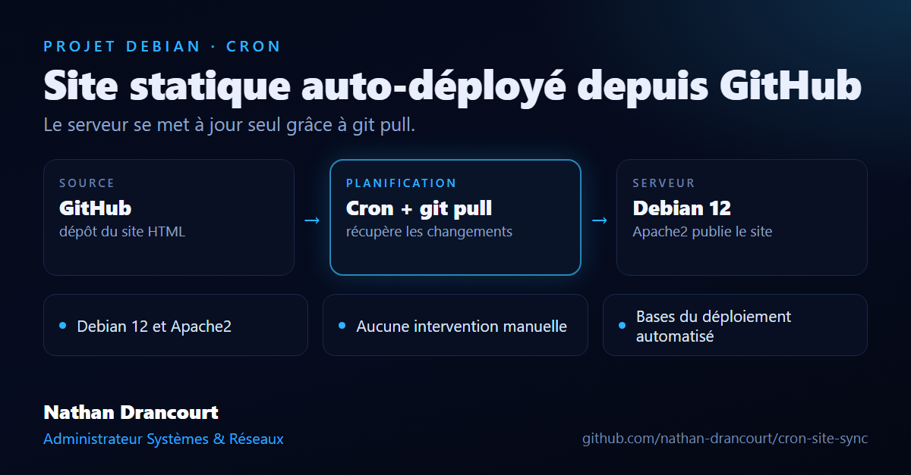

# WebSync - Site statique auto-déployé depuis GitHub

Ce projet simple montre comment héberger un site HTML sur un serveur Debian avec Apache2, et le garder à jour automatiquement grâce à `cron` et `git pull` sur un dépôt GitHub.

🔧 Technologies : Debian 12, Apache2, Git, Cron
📁 Objectif : apprendre les bases du déploiement web automatisé
